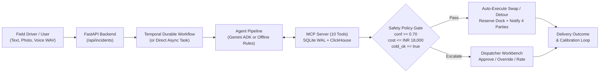

# Dock-to-Door: User & Administrator Guide

**Dock-to-Door** is an autonomous freight exception control and recovery system for the **348 km NH-48 corridor (Chennai Hub to Bengaluru Hub)**. When a truck encounters a mechanical fault, reefer cooling failure, cargo damage, or highway blockage, agents triage multimodal field reports, cross-check live sensor telemetry, evaluate candidate spare vehicles, and execute recovery plans behind a deterministic server-side safety gate.



---

## Part 1: User Guide (Field Drivers & Control Room Dispatchers)

The web interface at `http://127.0.0.1:8000` is organized as a **3-column operational ledger**:
- **Left Column (`01`–`03`)**: Field Exception Intake, Cold-Chain Telemetry Monitor, and Fleet & Spare Roster.
- **Center Column**: Interactive NH-48 Geospatial Map, Linear Relay Depot Schematic, and Active Shipment Manifest.
- **Right Column (`04`–`06`)**: Exception Dossier & Dispatcher Workbench, Feedback Loop & Learned Rules, and Outbound Dispatch Wire.

### 1. Submitting a Field Exception (`01 · Field Exception Intake`)
Drivers or field coordinators report transit exceptions from the top-left card (`web/src/app/app.component.html`):

1. **Select Active Transit Vehicle**: Choose one of the 6 active trucks (`TRK-1` through `TRK-6`) currently hauling a shipment on the NH-48 corridor. Selecting a vehicle immediately updates the **Cold-Chain Telemetry** chart (`02`) and highlights the unit in the **Fleet Roster** (`03`).
2. **Use a Quick Scenario Preset (or enter custom report)**:
   - **Reefer failure + pallet damage (`TRK-3`)**: Critical insulin & vaccine load (`2°C–8°C`). Telemetry corroborates rising box temperature, triggering an **automatic spare reefer swap**.
   - **Compressor noise / telemetry check (`TRK-4`)**: Driver reports a failing reefer on a dairy load, but live telemetry shows a steady `2.5°C` box temperature. The cross-modal discrepancy lowers confidence and **escalates to a human dispatcher**.
   - **Engine seized at toll plaza (`TRK-5`)**: Non-drivable breakdown requiring roadside transfer rather than a relay depot handover.
   - **Highway flooded ahead (`TRK-2`)**: Road blockage where the truck remains healthy and takes an **in-place route detour**.
   - **Unverified driver report (`TRK-1`)**: Vague report (`"something is wrong with the truck"`), scoring `0.35` confidence and pausing for **human approval**.
3. **Attach Multimodal Evidence (Optional)**:
   - **Attach cargo photo**: Upload a photo of damaged pallets or shipping labels. In ADK mode, Gemini inspects pallet damage (`none`, `salvageable`, `partial_loss`, `total_loss`) and counts affected pallets.
   - **Record voice note**: Click **Record voice note** to capture microphone audio, which is converted client-side into a `16 kHz` mono WAV file (`toWav()` in `web/src/app/app.component.ts`). In ADK mode, mixed Tamil and English speech is transcribed into English.
4. **Choose Execution Pipeline**:
   - `Pipeline: Auto (ADK if key set)`: Uses the multi-agent Gemini ADK pipeline when `GOOGLE_API_KEY` is configured, or falls back to deterministic offline rules.
   - `Pipeline: Deterministic Offline`: Forces the fast, zero-key rule-based pipeline.
   - `Pipeline: Force Gemini ADK`: Forces the full 5-stage LLM agent pipeline (`triage_agent` -> `scout_agent` -> parallel `assess_*` fan-out -> `planner_agent` -> `action_agent`).
5. Click **Dispatch to Agents ->**.

---

### 2. Monitoring Cold-Chain Telemetry & Corridor Map (`02` & `03` + Center Pane)
- **Cold-Chain Telemetry (`02`)**:
  - For refrigerated loads (`TRK-3` and `TRK-4`), displays the 40-minute box sensor curve against the **`8.0°C` excursion ceiling** (dashed red line), current temperature, and drift rate (`°C/min`).
  - Cargo exposed to temperatures above `8.0°C` for more than `60` cumulative minutes spoils; the planner calculates whether a replacement reefer can reach the handover point before spoilage.
- **Fleet & Spare Roster (`03`)**:
  - Filter the 11 corridor vehicles (`6` active trucks + `5` spare vehicles stationed at relay depots) by **All**, **Transit**, **Spares**, or **Reefer**.
  - Click any vehicle row to pan the map to its coordinates and inspect its telemetry.
- **Geospatial Map & NH-48 Relay Schematic (Center Pane)**:
  - **Solid amber dashed line**: Replacement vehicle's approach leg to the handover point.
  - **Solid green line**: Recovery leg from the handover point to the final consignee destination.
  - **Gold marker**: Handover location (either roadside at the breakdown coordinates or a relay depot ahead on NH-48 if the broken truck is still drivable).
  - **Active Shipment Manifest**: Bottom table listing all shipments (`S-101` to `S-106`), consignees, pallet counts, priority tiers (`critical`, `priority`, `standard`), and current recovery status.

---

### 3. Reviewing, Approving & Overriding Decisions (`04 · Exception Dossier & Workbench`)
When an exception is selected in the top tab strip of Section `04`:

1. **Pipeline Stage Progress**: Shows live progress across `01 Triage` -> `02 Scout` -> `03 Assess` -> `04 Gate` -> `05 Dispatch`.
2. **Triage Assessment (`04A`)**: Displays classified incident type, severity, confidence score, pallet damage, drivability, and thermal excursion risk.
3. **Recovery Decision & Safety Gate Card**:
   - Shows the chosen recovery action (`Vehicle Swap -> SPR-X` or `Route Detour`), handover location, predicted recovery duration, local IST ETA, remaining SLA margin, cold-chain protection status, cost in INR, and effective confidence.
   - **If `status == pending_approval`**: The banner explains which safety gate rule triggered human escalation (e.g., confidence below `0.70`, cost above `INR 18,000`, or cold-chain breach risk).
     - Click **Approve & Dispatch** to execute the recommended plan immediately (signals the waiting Temporal workflow if Temporal is active).
     - Click **Dispatcher Override** to open the manual override drawer.
4. **Dispatcher Manual Override**:
   - Lists all feasible replacement vehicles with their predicted minutes, cost in INR, and cold-chain status, plus a diagnostic breakdown of **Excluded units** (e.g., `SPR-2: not a reefer; cargo needs 2-8C`).
   - Enter an override rationale and click **Commit Override**. If the agent had already auto-dispatched a vehicle, overriding atomically releases the previous spare unit back to `available` and dispatches your selected unit.
5. **Endorse or Flag (`+1 Endorse` / `-1 Flag`)**: Rate any decision to record human quality feedback in SQLite and ClickHouse.

---

### 4. Closing the Loop: Outcomes & Outbound Messages (`05` & `06`)
- **Simulate Delivery Outcome**: On any `executed` decision, click **Simulate Delivery Outcome**. This records the actual recovery duration (`actual_min`) and whether the SLA held (`sla_held`), marks the shipment `delivered`, and triggers the post-outcome **Review** step.
- **Feedback Loop & Learned Rules (`05`)**:
  - Once `2` or more incidents of the same type have recorded outcomes, the learner compares predicted vs. actual recovery times and dispatcher override counts.
  - It writes active calibration rules (such as `+29% ETA buffer` for `reefer_failure` or `-0.10 confidence penalty` after repeated overrides) that automatically adjust future plans.
- **Outbound Dispatch Wire (`06`)**:
  - Displays all notifications sent for each incident across 4 parties: `driver`, `replacement_driver`, `customer` (never shown internal costs), and `dispatcher`.

---

## Part 2: Administrator Guide (Setup, Operations & Policy Configuration)

### 1. Environment & Configuration (`.env`)
All runtime settings are loaded in `app/config.py`. Copy `.env.example` to `.env` to configure:

| Variable | Default | Purpose |
| :--- | :--- | :--- |
| `GOOGLE_API_KEY` | *(empty)* | Enables live Gemini multimodal ADK agents (`adk()` in `app/agents.py`). When unset, runs deterministic offline rules. |
| `GEMINI_MODEL` | `gemini-2.5-flash` | Gemini model used by `triage_agent`, `scout_agent`, `assess_*`, `planner_agent`, and `action_agent`. |
| `GOOGLE_MAPS_API_KEY` | *(empty)* | Enables live traffic-aware **Google Routes API** (`computeRoutes`) in `app/geo.py`. Falls back to Haversine road-factor ETAs when unset. |
| `TEMPORAL_URL` | *(empty)* | Set to `localhost:7233` (or `temporal:7233` in Docker) to run incidents as durable Temporal workflows (`app/temporal_workflows.py`). |
| `CLICKHOUSE_URL` | *(empty)* | Set to `http://localhost:8123` to mirror `telemetry`, `tool_log`, and `decision_events` to ClickHouse and enable OLAP fleet drift scans. |
| `CLICKHOUSE_USER` / `CLICKHOUSE_PASSWORD` | `default` / *(empty)* | ClickHouse credentials (`d2d` / `d2d` in `docker-compose.yml`). |
| `D2D_DB` | `data/d2d.sqlite` | Path to the primary SQLite WAL database file. |
| `NIGHTLY_REVIEW_MIN` | `1440` | Interval in minutes for the recurring Temporal `NightlyReviewWorkflow` timer. |
| `HOST` / `PORT` | `127.0.0.1` / `8000` | Bind address and port for Uvicorn (`run.py`). |

---

### 2. Running the Stack (3 Deployment Modes)

#### Mode A: Full Docker Compose Stack (Recommended for Production / Demo)
Starts PostgreSQL, Temporal Server (`1.32.0`), Temporal Web UI (`:8080`), ClickHouse (`:8123`), and the Dock-to-Door app container (`:8000`):
```bash
docker compose up --build -d
```
- **Web Control Room**: `http://localhost:8000`
- **Temporal Web UI**: `http://localhost:8080` (inspect `incident-<id>` workflows and `dock-to-door-nightly-review`)
- **Health Endpoint**: `curl http://localhost:8000/api/health`

#### Mode B: Local Python Process (Zero-Dependency or Hybrid)
Run directly with `.venv/bin/python`:
```bash
.venv/bin/python run.py
```
- Works out of the box with zero external services (uses SQLite WAL in `data/d2d.sqlite`, Haversine routing, and offline/ADK agents).
- If local Temporal (`localhost:7233`) and ClickHouse (`http://localhost:8123`) are exported in `.env`, the single `run.py` process automatically starts the embedded Temporal worker thread (`start_worker_thread()` in `app/temporal.py`) on startup.

#### Mode C: Rebuilding the Angular Frontend
Whenever you modify files under `web/src/`, compile the production bundle directly into `app/static/` (which FastAPI serves at `/`):
```bash
npm --prefix web run build
```

---

### 3. Admin Controls, Safety Thresholds & Reset Operations

- **Resetting the Fleet & Database**:
  - **Via UI**: Click **Reset Ledger** in the top-right masthead.
  - **Via CLI / API**:
    ```bash
    curl -X POST http://127.0.0.1:8000/api/reset
    # or re-seed directly via Python:
    .venv/bin/python -m app.seed
    ```
    This resets SQLite tables (`vehicles`, `shipments`, `depots`, `telemetry`, `incidents`, `decisions`, `rules`, `notifications`), recreates ClickHouse tables (`telemetry`, `tool_log`, `decision_events`) with `DateTime('UTC')`, and seeds 41 minutes of fresh corridor telemetry.

- **Triggering Manual Policy Calibration**:
  - **Via UI**: Click **Run Calibration Job Now** in Section `05`.
  - **Via API**: `curl -X POST http://127.0.0.1:8000/api/learn`

- **Tuning Server-Side Safety Gate Policy**:
  The safety policy is enforced inside `reroute()` in `app/tools.py` so no prompt injection or LLM hallucination can bypass it. Admins can adjust thresholds in `app/config.py` and `app/tools.py`:
  - `MIN_CONFIDENCE = 0.7`: Minimum effective confidence required for autonomous execution.
  - `AUTO_COST_LIMIT_INR = 18000.0`: Maximum recovery cost in INR allowed without human sign-off.
  - `COLD_TOLERANCE_MIN = 60`: Maximum cumulative minutes above `8.0°C` before cold-chain cargo is flagged at risk.
  - `LEARN_MIN_SAMPLES = 2`: Minimum resolved cases of an incident type before the learner writes an ETA buffer rule.

---

### 4. Connecting External MCP Clients (Claude Desktop / Inspector)
Dock-to-Door exposes all 10 logistics tools via its standalone MCP server (`app/mcp_server.py`):
- **Stdio transport**:
  ```bash
  .venv/bin/python -m app.mcp_server
  ```
- **Streamable HTTP transport (`:8001`)**:
  ```bash
  .venv/bin/python -m app.mcp_server --http
  ```

### 5. Running End-to-End Verification (`tests/e2e_test.py`)
With Temporal (`localhost:7233`) and ClickHouse (`http://localhost:8123`) running, execute the 14-check automated verification suite:
```bash
.venv/bin/python tests/e2e_test.py
```
This verifies MCP stdio tool discovery, durable auto-swap execution, post-outcome review rule generation, cross-modal telemetry escalation, durable workflow survival across a simulated `SIGKILL` server crash (`srv.kill()`), ClickHouse table mirroring, and the recurring `dock-to-door-nightly-review` workflow.
