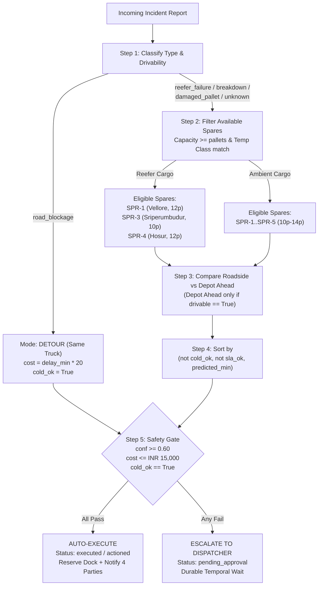

# Dock-to-Door: Deterministic State Machine, Decision Ruleset & Manual Optimal-Path Tracer

This document specifies every state, constraint equation, candidate ranking rule, and safety gate threshold implemented in [app/tools.py](file:///Users/mahas/Personal/agent-wars/app/tools.py), [app/agents.py](file:///Users/mahas/Personal/agent-wars/app/agents.py), [app/seed.py](file:///Users/mahas/Personal/agent-wars/app/seed.py), and [app/temporal_workflows.py](file:///Users/mahas/Personal/agent-wars/app/temporal_workflows.py). Use the **Manual Optimal-Path Worksheet** in Section 6 to hand-trace the exact decision for any incident.

---

## 1. Entity State Spaces & Transitions

### 1.1 Vehicle States (`vehicles.status`)
| State | Meaning | Eligible as Replacement? | Transition Trigger |
| :--- | :--- | :--- | :--- |
| `in_transit` | Hauling an active shipment (`S-101`–`S-106`) along NH-48 | Only for `road_blockage` self-detour (`repl_id == broken_vehicle`) | Initial seed state for `TRK-1`..`TRK-6` |
| `available` | Spare unit parked at a relay depot (`SPR-1`..`SPR-5`) or post-delivery truck | **Yes** (required for `swap` mode) | Initial seed state for `SPR-1`..`SPR-5`, or `simulate_outcome()` / `override_decision()` release |
| `dispatched` | Assigned to a swap decision and en route to handover point | **No** (atomic SQLite conditional `UPDATE ... WHERE status='available'`) | `_execute()` when `mode == 'swap'` |
| `out_of_service` | Disabled truck after `reefer_failure`, `breakdown`, or `unknown` swap | **No** | `_execute()` when `incident_type IN ('reefer_failure', 'breakdown', 'unknown')` |

### 1.2 Shipment States (`shipments.status`)
```
[in_transit] ──(_execute on executed/approved/overridden decision)──> [recovering] ──(simulate_outcome)──> [delivered]
```

### 1.3 Incident & Temporal Workflow States (`incidents.status` / `IncidentWorkflow`)
```
[running] ──(reroute auto-executes)──────────────────────> [actioned] ──(outcome + review)──> [workflow COMPLETED]
    │
    ├──────(reroute escalates: low conf / high cost / cold breach)──> [awaiting_approval]
    │                                                                        │
    │                                               (dispatcher approve / override signal)
    │                                                                        ▼
    │                                                                   [actioned]
    └──────(no feasible candidate OR unhandled pipeline error)────────> [needs_human]
```

### 1.4 Decision States (`decisions.status`)
| State | Condition | Next Allowed Transitions |
| :--- | :--- | :--- |
| `executed` | Passed all safety gates automatically, or approved/overridden by human | `overridden` (via `override_decision`), or outcome recorded (`actual_min` populated) |
| `pending_approval` | Escalated by safety gate (`confidence < 0.6`, `cost_inr > 15000`, or `cold_ok == False`) | `executed` (via `approve_decision`), `overridden` (via `override_decision`), `failed` (if spare vehicle taken concurrently) |
| `overridden` | Superseded by a human dispatcher's manual vehicle selection | Terminal state (creates a new linked decision with `override_of = old.vehicle_id`) |
| `rejected` | Invalid vehicle, capacity/reefer mismatch, or duplicate active decision | Terminal state (not persisted or rejected before execution) |
| `failed` | Lost atomic vehicle claim race (`status='available'` check returned `0` rows) | Terminal state |

---

## 2. Corridor Fleet, Shipments & Relay Depots (Baseline State)

### 2.1 NH-48 Relay Depots (East $\to$ West)
| Depot ID | Name | Coordinates (`lat, lon`) | Dock Slots | Stationed Spare Vehicles |
| :--- | :--- | :--- | :--- | :--- |
| `DEP-CHN` | Chennai Hub | `13.0827, 80.2707` | 4 | `SPR-5` (Hari, `ambient`, 14 plt) |
| `DEP-SPR` | Sriperumbudur Depot | `12.9675, 79.9416` | 2 | `SPR-3` (Dinesh, `reefer`, 10 plt) |
| `DEP-VEL` | Vellore Depot | `12.9165, 79.1325` | 2 | `SPR-1` (Prakash, `reefer`, 12 plt) |
| `DEP-KRI` | Krishnagiri Depot | `12.5186, 78.2137` | 2 | `SPR-2` (Bala, `ambient`, 14 plt) |
| `DEP-HSR` | Hosur Depot | `12.7409, 77.8253` | 3 | `SPR-4` (Gopal, `reefer`, 12 plt) |
| `DEP-BLR` | Bengaluru Hub | `12.9716, 77.5946` | 4 | *(none initially)* |

### 2.2 Active Transit Trucks (`TRK-1`..`TRK-6`)
| Vehicle | Shipment | Corridor Pos | Class | Cargo | Pallets | Destination | SLA Slack | Telemetry Profile |
| :--- | :--- | :--- | :--- | :--- | :--- | :--- | :--- | :--- |
| `TRK-1` | `S-101` | `15%` (near Sriperumbudur) | `ambient` | Consumer electronics | 8 | Flipkart Hub - Devanahalli | `+240 min` | `~28.0°C` ambient |
| `TRK-2` | `S-102` | `30%` (east of Vellore) | `ambient` | Appliances | 7 | Reliance Retail - Electronic City | `+200 min` | `~28.0°C` ambient |
| `TRK-3` | `S-103` | `43%` (west of Vellore) | `reefer` | Insulin & vaccines (`2-8C`) | 6 | Apollo Pharmacy DC - Whitefield | `+150 min` | **Failing**: rises from `2.0°C` to `~10.4°C` (`+0.28°C/min`, `>8°C` for ~9 min) |
| `TRK-4` | `S-104` | `60%` (near Krishnagiri) | `reefer` | Dairy & frozen (`2-8C`) | 8 | BigBasket Hub - Yeshwanthpur | `+220 min` | **Healthy**: steady `~2.5°C` (`0.00°C/min` drift, `0` min above `8°C`) |
| `TRK-5` | `S-105` | `75%` (between Krishnagiri & Hosur) | `ambient` | Medical consumables | 5 | Narayana Health - Bommasandra | `+150 min` | `~28.0°C` ambient |
| `TRK-6` | `S-106` | `85%` (west of Hosur) | `ambient` | Auto parts | 9 | Bosch Peenya - Peenya | `+120 min` | `~28.0°C` ambient |

---

## 3. Step-by-Step Decision Ruleset

### Step 1: Triage & Cross-Modal Telemetry Verification
1. **Classify `raw_type` $\in$ `{reefer_failure, damaged_pallet, breakdown, road_blockage, unknown}`**:
   - In offline mode, keyword match against `KW` dictionary:
     - `reefer_failure`: `reefer, cooling, refrigerat, temperature, compressor, chiller, not cold, warm`
     - `breakdown`: `breakdown, broke down, engine, tyre, tire, puncture, clutch, axle, won't start, not starting, accident, seized`
     - `damaged_pallet`: `damage, crushed, fell, spill, leak, torn, collapsed, pallet`
     - `road_blockage`: `flood, blocked, landslide, protest, jam, closure, closed road`
   - Base offline confidence:
     - `>= 2` keyword hits $\implies \text{conf}_0 = 0.85$
     - `1` keyword hit $\implies \text{conf}_0 = 0.70$
     - `0` keyword hits (`unknown`) $\implies \text{conf}_0 = 0.35$
2. **Determine Drivability (`drivable`)**:
   - `drivable = True` if `vehicle_drivable == True` AND `raw_type != 'unknown'` (in offline mode: `raw_type in ('reefer_failure', 'damaged_pallet')` and `"won't"` not in text).
   - Otherwise `drivable = False`.
3. **Cross-Check Telemetry (if `raw_type == 'reefer_failure'`)**:
   - Compute telemetry anomaly over the last 30 minutes:
     $$\text{anomaly} = (\text{trend\_c\_per\_min} > 0.10) \lor (\text{latest\_temp\_c} > 8.0)$$
   - **Corroborated (`anomaly == True`)**: $\text{conf}_1 = \min(0.95,\ \text{conf}_0 + 0.08)$
   - **Contradicted (`anomaly == False`)**: $\text{conf}_1 = \max(0.20,\ \text{conf}_0 - 0.30)$

---

### Step 2: Candidate Generation & Hard Constraint Filtering (`find_alternate_vehicles`)

#### Case A: `raw_type == 'road_blockage'` (Detour Mode)
- Only candidate is the **same truck** (`repl_id = broken_vehicle`, `mode = 'detour'`).
- Calculations:
  - $\text{raw\_min} = \text{route}(\text{truck} \to \text{dest}).\text{minutes} + \text{delay\_min}$ (default `delay_min = 60`)
  - $\text{cost\_inr} = \text{delay\_min} \times 20$
  - $\text{cold\_ok} = \text{True}$, $\text{t\_transfer} = 0$, $\text{pallets\_moved} = 0$

#### Case B: All Other Incident Types (`reefer_failure`, `damaged_pallet`, `breakdown`, `unknown` $\to$ Swap Mode)
Every vehicle `rv` with `status == 'available'` is evaluated against **3 hard constraints**:
1. **Availability**: `rv.status == 'available'`
2. **Pallet Capacity**:
   - Let $\text{move} = \text{pallets\_affected}$ if `type == 'damaged_pallet'` and $\text{pallets\_affected} > 0$, else `shipment.pallets`.
   - Reject if `rv.capacity < move`.
3. **Temperature Class**:
   - If `shipment.temp_class == 'reefer'`, reject if `rv.temp_class != 'reefer'`.

---

### Step 3: Handover Point Selection per Candidate (Roadside vs. Relay Depot Ahead)
For each eligible spare vehicle `rv`:
1. **Option 1 — Roadside at Breakdown Point** (always evaluated):
   - $\text{t\_meet} = \text{route}(\text{rv} \to \text{truck}).\text{minutes}$
   - $\text{t\_transfer} = \text{t\_meet} + 25\text{ min}$ (`HANDLING_MIN = 25`)
   - $\text{raw\_min} = \text{t\_transfer} + \text{route}(\text{truck} \to \text{dest}).\text{minutes}$
2. **Option 2 — Relay Depot Ahead** (evaluated **only if `drivable == True`**):
   - Find the nearest depot $D$ such that:
     $$\text{dist}(D, \text{dest}) < \text{dist}(\text{truck}, \text{dest}) - 3\text{ km} \quad \text{and} \quad \text{dist}(\text{truck}, D) \le 90\text{ km}$$
   - If such a depot $D$ exists:
     - $\text{t\_meet} = \max\big(\text{route}(\text{truck} \to D).\text{minutes},\ \text{route}(\text{rv} \to D).\text{minutes}\big)$
     - $\text{t\_transfer} = \text{t\_meet} + 25\text{ min}$
     - $\text{raw\_min} = \text{t\_transfer} + \text{route}(D \to \text{dest}).\text{minutes}$
3. **Cold-Chain Survival Check (`cold_ok`)**:
   - For a `reefer` shipment under `reefer_failure` or `breakdown`:
     - If $\text{latest\_temp\_c} > 8.0$: $\text{spoilage\_in\_min} = \max(0,\ 60 - \text{minutes\_above\_limit})$
     - Else if $\text{trend} > 0.02$: $\text{spoilage\_in\_min} = \frac{8.0 - \text{latest\_temp\_c}}{\text{trend}} + 60$
     - Else: $\text{spoilage\_in\_min} = 60$
   - $\text{cold\_ok} = (\text{t\_transfer} \le \text{spoilage\_in\_min})$
4. **Pick Best Handover for `rv`**:
   - Sort `[Option 1, Option 2]` by `(not cold_ok, raw_min)` and pick the minimum.
5. **Apply Learned Rules & Compute Cost**:
   - Fetch learned `eta_buffer_pct` for `raw_type` (default `0%`).
   - $\text{predicted\_min} = \text{round}\big(\text{raw\_min} \times (1 + \text{eta\_buffer\_pct}/100)\big)$
   - $\text{sla\_ok} = (\text{predicted\_min} \le \text{sla\_remaining\_min})$
   - $\text{cost\_inr} = \text{round}\big((\text{km}_{\text{leg1}} + \text{km}_{\text{leg2}}) \times 38 + 1500\big)$

---

### Step 4: Ranking Candidates & Selecting the Optimal Vehicle
All feasible candidate plans are sorted in ascending lexicographical order by:
$$\text{Sort Key} = \big(\ \neg\text{cold\_ok},\quad \neg\text{sla\_ok},\quad \text{predicted\_min}\ \big)$$
- **Priority 1**: Preserves cold chain (`cold_ok == True` beats `False`).
- **Priority 2**: Meets customer SLA window (`sla_ok == True` beats `False`).
- **Priority 3**: Lowest total predicted recovery minutes (`predicted_min`).

---

### Step 5: Server-Side Safety Policy Gate (`reroute`)
Once the optimal candidate is selected, compute effective confidence:
1. **SLA Confidence Adjustment (Offline Agent)**:
   $$\text{conf}_{\text{plan}} = \text{conf}_1 \times \begin{cases} 1.00 & \text{if } \text{sla\_ok} \\ 0.85 & \text{if } \neg\text{sla\_ok} \end{cases}$$
2. **Learned Override Penalty (`reroute`)**:
   $$\text{conf}_{\text{eff}} = \max\big(0.0,\ \min(1.0,\ \text{conf}_{\text{plan}}) - \text{conf\_penalty}\big)$$
   *(where `conf_penalty = 0.10` if human dispatchers have overridden `raw_type` $\ge 2$ times, else `0.0`)*
3. **Evaluate the 3 Hard Gate Conditions**:
   | Gate Rule | Threshold (`app/config.py`) | Escalation Reason if Violated |
   | :--- | :--- | :--- |
   | **1. Confidence Gate** | $\text{conf}_{\text{eff}} \ge 0.60$ (`MIN_CONFIDENCE`) | `confidence <X> below threshold 0.6` |
   | **2. Cost Ceiling Gate** | $\text{cost\_inr} \le 15000$ (`AUTO_COST_LIMIT_INR`) | `cost INR <X> exceeds auto limit 15000` |
   | **3. Cold-Chain Gate** | $\text{cold\_ok} == \text{True}$ | `cold chain breaches before transfer completes; human should consider salvage or nearest cold store` |

- **If ALL 3 gates pass**:
  - `decision.status = 'executed'`, `incident.status = 'actioned'`
  - Vehicle statuses updated atomically (`rv -> dispatched`, `broken -> out_of_service` if breakdown/reefer/unknown)
  - If `meet_depot` is set: `reserve_dock_slot(meet_depot, incident_id, 30)`
  - Send 4 notifications (`driver`, `replacement_driver`, `customer`, `dispatcher`)
- **If ANY gate fails**:
  - `decision.status = 'pending_approval'`, `incident.status = 'awaiting_approval'`
  - Temporal workflow pauses at `workflow.wait_condition` (`status = 'awaiting_dispatcher'`)
  - Only `dispatcher` is notified with recommendation and escalation reasons.

---

## 4. Decision Matrix: All Canonical Scenarios



| Scenario | Vehicle & Cargo | Triage Type & Drivable | Telemetry Cross-Check | Eligible Spares | Optimal Pick & Handover | Gate Check (`conf`, `cost`, `cold_ok`) | Final Outcome |
| :--- | :--- | :--- | :--- | :--- | :--- | :--- | :--- |
| **1. Reefer failure + crushed pallets** | `TRK-3` (`S-103`, 6 plt reefer, Whitefield) | `reefer_failure`, `drivable = True` | Anomaly confirmed (`~10.4°C`, `+0.28°C/min`) $\to \text{conf} = 0.93$ | `SPR-1`, `SPR-3`, `SPR-4` (`SPR-2`, `SPR-5` excluded: ambient) | **`SPR-1`** (stationed at Vellore Depot, closest to `TRK-3` at 43% along corridor) | `conf = 0.93 >= 0.60`<br>`cost ~ INR 8,427 <= 15,000`<br>`cold_ok = True` (under Haversine) | **`executed`** (Auto-Swap) |
| **2. Reefer report with healthy telemetry** | `TRK-4` (`S-104`, 8 plt reefer, Yeshwanthpur) | `reefer_failure`, `drivable = True` | **No anomaly** (`2.5°C` flat) $\to$ conf penalized `0.85 - 0.30 = 0.55` | `SPR-1`, `SPR-3`, `SPR-4` | **`SPR-4`** (Hosur Depot) or **`SPR-1`** depending on depot ahead | **`conf = 0.55 < 0.60`** (fails confidence gate!) | **`pending_approval`** (Escalated to human) |
| **3. Engine seized at toll plaza** | `TRK-5` (`S-105`, 5 plt ambient, Bommasandra) | `breakdown`, `drivable = False` (`"won't start"`) | N/A (`ambient`) $\to \text{conf} = 0.85$ | `SPR-1`..`SPR-5` (all have capacity $\ge 5$) | **`SPR-4`** (at Hosur) or **`SPR-2`** (at Krishnagiri), **Roadside handover** (`drivable=False`) | `conf = 0.85 >= 0.60`<br>`cost <= 15,000`<br>`cold_ok = True` | **`executed`** (Auto-Swap at roadside) |
| **4. Highway flooded ahead** | `TRK-2` (`S-102`, 7 plt ambient, Electronic City) | `road_blockage`, `drivable = False` | N/A (`ambient`) $\to \text{conf} = 0.85$ | **`TRK-2`** (self-detour only) | **`TRK-2` Detour** (`continue on alternate route`, `+60 min` delay) | `conf = 0.85 >= 0.60`<br>`cost = INR 1,200 <= 15,000`<br>`cold_ok = True` | **`executed`** (Auto-Detour) |
| **5. Vague driver message** | `TRK-1` (`S-101`, 8 plt ambient, Devanahalli) | `unknown` (mapped to `breakdown` for planning), `drivable = False` | N/A $\to \text{conf} = 0.35$ | `SPR-1`..`SPR-5` (all have capacity $\ge 8$) | **`SPR-3`** (at Sriperumbudur Depot, closest to `TRK-1` at 15%) | **`conf = 0.35 < 0.60`** (fails confidence gate!) | **`pending_approval`** (Escalated to human) |

---

## 5. Post-Outcome Feedback & Calibration Ruleset

When `simulate_outcome(decision_id)` runs on an `executed` decision:
1. **Simulated Actual Recovery Time**:
   $$\text{actual\_min} = \text{round}\big(\text{predicted\_raw\_min} \times \text{FACTOR}[\text{incident\_type}] \times \text{Uniform}(0.96, 1.04)\big)$$
   where:
   - `FACTOR["reefer_failure"] = 1.30`
   - `FACTOR["breakdown"] = 1.18`
   - `FACTOR["unknown"] = 1.15`
   - `FACTOR["damaged_pallet"] = 1.10`
   - `FACTOR["road_blockage"] = 1.05`
2. **Calibration Rule Generation (`learn()` / `feedback.review()`)**:
   - Triggered when resolved count for `incident_type` $\ge 2$ (`LEARN_MIN_SAMPLES = 2`):
     $$\text{ratio} = \text{mean}\left(\frac{\text{actual\_min}}{\text{predicted\_raw\_min}}\right)$$
     $$\text{eta\_buffer\_pct} = \begin{cases} \text{clamp}_{[0, 60]}\big(\text{round}((\text{ratio} - 1) \times 100)\big) & \text{if } |\text{ratio} - 1| \ge 0.08 \\ 0 & \text{otherwise} \end{cases}$$
   - If dispatcher `overridden` count for `incident_type` $\ge 2$:
     $$\text{conf\_penalty} = 0.10 \quad (\text{clamped to } [0.0, 0.30])$$
   - On the **next** incident of that type, `_plan_for` multiplies `raw_min` by `(1 + eta_buffer_pct / 100)` and `reroute` subtracts `conf_penalty` from `confidence`.

---

## 6. Manual Optimal-Path Worksheet (Trace Any Custom Situation)

To manually trace the system's exact decision for any input:

1. **Identify Shipment & Vehicle**:
   - Look up `vehicle_id` in Table 2.2 $\to$ get `temp_class` (`reefer` or `ambient`), `pallets`, and corridor position.
2. **Determine Incident Type & Base Confidence**:
   - Count keyword matches in driver message $\to$ `0 hits = unknown (0.35)`, `1 hit = 0.70`, `>=2 hits = 0.85`.
   - If `reefer_failure`: check if `vehicle_id == TRK-3` (anomaly `True` $\to +0.08$) or `TRK-4` (anomaly `False` $\to -0.30$).
3. **Branch on Mode**:
   - If `road_blockage` $\to$ **Detour** with same vehicle (`cost = delay_min * 20`, `cold_ok = True`). Jump to Step 5.
   - Otherwise $\to$ **Swap**: list all `available` spares in Table 2.1.
     - Cross out `SPR-2` and `SPR-5` if shipment is `reefer`.
     - Cross out any spare whose `capacity < pallets_to_move`.
4. **Pick Nearest Eligible Spare & Handover Mode**:
   - If `drivable == True` (`reefer_failure` or `damaged_pallet` without `"won't"`), check if a depot in Table 2.1 lies ahead within `90 km` closer to destination; compare depot handover time vs. roadside handover time (`t_meet + 25 min + leg2`).
   - If `drivable == False`, use roadside handover at the broken truck's coordinates.
   - Pick the spare with `(cold_ok == True, sla_ok == True, minimum predicted_min)`.
5. **Apply the 3 Safety Gate Checks**:
   - Subtract any learned `conf_penalty` from confidence.
   - Ask:
     1. Is $\text{confidence} \ge 0.60$?
     2. Is $\text{cost\_inr} \le 15,000$?
     3. Is $\text{cold\_ok} == \text{True}$ ($t_{\text{transfer}} \le t_{\text{spoilage}}$)?
   - **All 3 Yes** $\implies$ **`executed`** (auto-swap/detour + dock reservation + 4 notifications).
   - **Any No** $\implies$ **`pending_approval`** (escalates to dispatcher workbench; Temporal workflow waits at `awaiting_dispatcher`).
